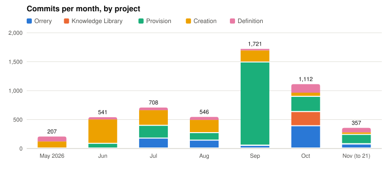

# Frank Epps Jr.

**Systems integrator. I've worked on rockets, aircraft and robots; now I build and connect AI systems for businesses.**

## AI for local businesses — start here

- **A client repair.** When a workflow failed for customers, I traced the problem to the app’s data and rebuilt the failing step. The owner kept their login and controlled when the fix went live. [Read the case study](https://github.com/sorry2befrank/portfolio/blob/main/work/client-work.md)
- **A business visit.** Try preparing an owner brief for a fictional bakery. Understudy Audit keeps meeting notes on your device and asks for evidence before a finding goes into the client summary. [Open the demo](https://sorry2befrank.github.io/understudy-audit/audit-app.html)
- **Classes.** Start with your first AI account in AI Basics, or bring an idea to the 30-Day Workshop and build a tool around it. [See the classes](https://understudy.consulting/)
- **Engineering details.** Browse the case studies or inspect Knowledge Library, an archive that lets AI assistants retrieve documents with citations. The public release was tested on synthetic data. [Portfolio](https://github.com/sorry2befrank/portfolio) · [Knowledge Library code](https://github.com/sorry2befrank/knowledge-library)

## My personal AI system

I am building a personal AI system unique to me, and a skeleton anyone can use to build their own. It has five major projects: **the Orrery**, which oversees the whole system; **the Knowledge Library**, its memory; and three areas of my life, each with its own AI boss agent: **Provision** (how I make a living), **Creation** (what I make for love) and **Definition** (who I am to other people). Underneath all five sits **Commons**, the shared machinery they all use.

## My work, measured

<picture>
  <source media="(prefers-color-scheme: dark)" srcset="img/activity-dark.svg">
  
</picture>

5,212 commits from May to November 2026 across my repositories, counted from git and not estimated. Each commit is counted once, even when the same repository is cloned in several places. Most of these repositories are private, so the counts are shown here; the code is not.

| Project | May | Jun | Jul | Aug | Sep | Oct | Nov | Total |
|---|---:|---:|---:|---:|---:|---:|---:|---:|
| Orrery | 0 | 0 | 172 | 136 | 45 | 385 | 82 | 820 |
| Knowledge Library | 0 | 0 | 0 | 0 | 5 | 245 | 5 | 255 |
| Provision | 0 | 81 | 220 | 130 | 1,437 | 263 | 158 | 2,289 |
| Creation | 122 | 357 | 107 | 168 | 169 | 61 | 52 | 1,036 |
| Definition | 85 | 38 | 45 | 51 | 25 | 147 | 77 | 468 |
| Commons | 0 | 65 | 164 | 61 | 40 | 11 | 3 | 344 |
| **All** | 207 | 541 | 708 | 546 | 1,721 | 1,112 | 377 | **5,212** |

**How these commits are made:** I direct AI coding agents (Claude Code and Codex). I write the specifications, decide what ships, and check the work with tests and reviews. 3,309 of the 5,212 commits (63%) carry an AI co-author line. The [build method](https://github.com/sorry2befrank/portfolio/blob/main/work/build-method.md) explains how this works.

## The Orrery

The Orrery is the control room I built to run a one-person AI operation. It maps every component and workflow, shows where each workflow is broken, and does bounded work overnight that I review. The rule behind it: *"unknown" is the default, not "fine".*

- **The Orrery**: a local control room that scans every project on my drive, sorts each onto a mountain, and shows the whole body of work as a table, an orrery and a 3D universe. *Running, local only; no public source.* [Case study](https://github.com/sorry2befrank/portfolio/blob/main/work/orrery.md)
- **The Armillary**: the nightly crew. 33 stages run in causal order, each with a watchdog and a receipt tied to a trace ID. 120 nights of unattended running between July and November 2026. New overnight work orders have been paused since 2026-10-18 while I redesign it; the nightly checks keep running. *Running.* [The nightly chain](https://github.com/sorry2befrank/portfolio/blob/main/work/orrery.md#4-the-nightly-chain)
- **System Atlas and Diagnosis**: a typed map of 56 components in 8 layers, and a check that walks each of 11 governed flows and names the first step with no proof. On 2026-11-20 it showed 0 of 11 flows fully verified, and it says so. *Running.* [The Atlas and the Diagnosis](https://github.com/sorry2befrank/portfolio/blob/main/work/orrery.md#1-the-atlas-and-the-diagnosis-observe)
- **The Understudy**: an AI agent that starts read-only and has to earn each permission on a record someone else checks. Its citation harness rejected 22 of 208 reports. It is on rung 2, which I granted and labelled as granted. *Running.* [Case study](https://github.com/sorry2befrank/portfolio/blob/main/work/understudy.md)
- **Two-model build loop**: one model writes the ticket and verifies the result; a second builds it in an isolated worktree under a sandbox. 65 tickets so far. *Running.* [The build method](https://github.com/sorry2befrank/portfolio/blob/main/work/build-method.md)
- **Voyage**: the public edition, a static 3D site you can fly through, with illustrative data in place of the private system. The build asserts that 18 private paths are absent. *Live* at [voyage.understudy.consulting](https://voyage.understudy.consulting). [Case study](https://github.com/sorry2befrank/portfolio/blob/main/work/voyage.md)
- **VR edition**: a private WebXR build of the same galaxy for the Meta Quest 3, with a walkable 32-metre glass dome and a walk/fly toggle. *Paused; built and tested in an emulator, not yet on a physical headset.* [The VR edition](https://github.com/sorry2befrank/portfolio/blob/main/work/voyage.md#the-vr-edition-paused)

Honest limit: the unattended repair lane is built and guarded, but across 35 attempts it has not yet landed a verified repair.

**Commit activity:** 820 unique commits across all branches, July to November 2026, in 4 repositories, none of them public (Orrery 601, Voyage 134, VR edition 74, workspace 11). 635 carry an AI co-author trailer. October was the busiest month, with 385. The case studies count the live branch only, so their numbers are lower.

## The Knowledge Library

Remember with sources. The Knowledge Library is an archive that AI assistants search and cite over MCP (the Model Context Protocol), so decisions, specs and receipts are cited instead of re-read. Its rule: nothing leaves the working set unless a verified copy exists and a restore is possible.

- **Knowledge Library, public release**: a versioned Markdown archive on Cloudflare Workers, with a Durable Object with SQLite for the index and R2 for storage. Built and tested on synthetic data only, MIT licensed. CI on 2026-11-20: 1,805 tests passed, 93 skipped. *Built, public.* [Code](https://github.com/sorry2befrank/knowledge-library) · [Case study](https://github.com/sorry2befrank/portfolio/blob/main/work/knowledge-library.md)
- **Private deployment**: the same system on Cloudflare, running since 2026-10-20. Every production step runs only from my own terminal, while I watch. Five of its eight planned MCP tools are built. *Supervised pilot.*
- **Safety design**: one write path, a single `apply()` function, and a lint fails the build if any other code runs a mutating SQL statement. A pure kernel decides removal, not a model, and property tests check it. Access control runs before ranking, so a denied note looks the same as a missing one. File moves are tested by injecting failures in the middle of a move. *Built.*
- **The librarian**: improves only by changing data playbooks. A changed playbook must beat the current champion on held-out cases before it is promoted. *Built.*
- **Weekly focus cycle**: moves notes that are no longer needed out of folders. *Designed, not built.* Its scheduled workflows do not exist yet.
- **Personal Brain MCP**: a read-only MCP server over approved notes, with keyword retrieval, citations and golden-set evals. Scope is enforced at retrieval: each chunk must match a live approved file by hash and line range. The launcher has read grants only, so a write attempt is refused. *Running; its project-list tool fails today.* [Write-up](https://github.com/sorry2befrank/portfolio/blob/main/work/tools.md#personal-brain-mcp-let-several-ai-apps-read-private-notes-safely)
- **Brain MCP design dossier**: the plan, audit, review, design and work orders behind the brain MCP. One model wrote the spec, another built it, and the first verified it. *Built.*
- **World-sharing**: letting other world-builders connect their own worlds, each kept in their own storage. *Planned, not designed.*

**Commit activity:** 255 commits since September 2026 across 3 repositories, mostly private (245 of them in October 2026).

## Provision

Provision is how I make a living: the consulting business, its tools, and the engines behind it. I run it as [Understudy](https://understudy.consulting), my studio for AI consulting, builds, and AI training for organizations. Its boss persona is the Executive.

- **The Executive**: the Provision boss persona and its workspace, with a directive, a crew, lanes and daily decision logs. *Running.* [How the personas work](https://github.com/sorry2befrank/portfolio/blob/main/work/understudy.md#how-it-works)
- **Understudy consulting site**: services, booking and an inquiry form, with Playwright tests. *Live* at [understudy.consulting](https://understudy.consulting) ([source](https://github.com/sorry2befrank/understudy)).
- **Understudy Audit**: an offline phone app for running a business audit in person. Saved audits stay on the device, and a finding can be exported only with a dated public source or a recorded owner confirmation. 36 of 36 tests pass in CI. *Live, public, MIT.* [Code](https://github.com/sorry2befrank/understudy-audit) · [case study](https://github.com/sorry2befrank/portfolio/blob/main/work/tools.md#understudy-audit-a-business-audit-app-that-works-offline)
- **Personal App Engine**: a private, local-first AI app builder. It has a control plane on SQLite with streamed run events, approval-gated file changes, encrypted secrets and sandboxed previews. *Running, private.*
- **Client work**: I rescued a live app that a client owns. The fault was in its data, which the schema did not show (*built*). I built Cosmic Atlas, a creator's astrology web app whose 88 planetary positions are checked against NASA JPL's Horizons system (*live*). I am building a mobile matching app and operator console for a client, with deny-by-default row-level security and a double-entry ledger (*running, in pilot*). Honest note: the core repair in the rescue was a short engagement, and I have no outcome metrics to quote. [Case study](https://github.com/sorry2befrank/portfolio/blob/main/work/client-work.md)
- **Sales previews and outreach**: about 50 redesign previews built for local businesses, and a guarded cold-email operator in which only one file may send, behind a suppression list, a daily cap and a kill switch. *Paused* (outreach since 2026-10-31). The Opportunity Scout still searches boards and forums each morning for paid-work requests and hands me one file of drafted replies (*running daily*).
- **Sachiel**: an options scanner with charts, a trade journal with a Bayesian learning loop, paper trades and a backtest engine. *Paused.*
- **This portfolio**: the case studies and one-page site that document this work. *Live.* [Repository](https://github.com/sorry2befrank/portfolio) · [site](https://sorry2befrank.github.io/portfolio/)

**Commit activity:** 2,289 commits from June to November 2026 across 32 repositories, mostly private. 1,678 of them are one client's matching app, and 1,437 landed in September. 1,209 carry an AI co-author trailer, and 150 exist only in local repositories (never pushed).

## Creation

What I would do for free: the Three Mountaintops books and the platform, studio and media around them. I write every word of the books myself; what is shown here is the platform and the tools around them. The Creation boss persona, **the Director**, is a production manager and canon guardian, and it never drafts prose. It is running ([The North Star](https://github.com/sorry2befrank/portfolio/blob/main/work/north-star.md#each-mountains-own-north-star)).

> my own platform I made. Complete with merch sales. That I built myself.
>
> *Spoken, 2026-11-21.*

- **Three Mountaintops World**: the platform for my four-book series. It has a reading site and living codex, 6 public films, a gallery of 325 art entries and the Lane merch shop, with checkout on Fourthwall. Live at [threemountaintops.world](https://threemountaintops.world). [Case study](https://github.com/sorry2befrank/portfolio/blob/main/work/three-mountaintops-world.md)
- **The Path**: a Godot 4.6 tactical RPG set in the world, behind an edge gate that checks the signed member cookie. Member-gated; the free public beta ended 2026-10-16. [The game](https://github.com/sorry2befrank/portfolio/blob/main/work/three-mountaintops-world.md#the-path-the-game)
- **The Studio**: my trailer and film desk. Story goes to shots and takes, each model's cost shows before you generate, and every character has one approved anchor image that other views are judged against. Running, local-only. [Production studio](https://github.com/sorry2befrank/portfolio/blob/main/work/production-studio.md)
- **Authors Codex**: a private workspace for novelists. Authors are kept apart by the database schema itself: 21 tables, all with row-level security. Live at [authors-codex.vercel.app](https://authors-codex.vercel.app). It has no automated tests yet. [Case study](https://github.com/sorry2befrank/portfolio/blob/main/work/authors-codex.md)
- **Live Presenter**: Markdown slide decks with private notes and a clean audience window for Zoom. Running; my class tool since 2026-11-02. [Streams and shorts](https://github.com/sorry2befrank/portfolio/blob/main/work/streams-and-shorts.md#live-presenter)
- **Stream Hub and the clip pipeline**: one local page that starts and stops my streams and recording through OBS, and a pipeline that cuts a long stream into short vertical clips. Stream Hub has run since 2026-09-28. The clip pipeline is a prototype, proven on one 98-minute stream. A clip uploads only if the approved file still matches its hash. [From stream to clips](https://github.com/sorry2befrank/portfolio/blob/main/work/streams-and-shorts.md#from-stream-to-clips)
- **Shorts Studio**: turns a script into a vertical short through a content-policy gate, narration and a local ffmpeg render. Built; nine finished shorts are on the Three Mountaintops YouTube channel. [A shorts pipeline](https://github.com/sorry2befrank/portfolio/blob/main/work/production-studio.md#a-shorts-pipeline)

**Commit activity:** 1,036 commits since May 2026 across 9 repositories. All of them are private or kept on my machine, so the history itself is not public. 647 of the commits carry an AI co-author line. The campaign engine's commits are counted under Commons.

## Definition

Definition tracks who a person is to other people. In my system it is built as machinery: a private personal system, a public reference library, and a seed that lets someone else start a system of their own. Michael's steward agent, a persona named Definition, reports to the [Orrery](https://github.com/sorry2befrank/portfolio/blob/main/work/orrery.md).

- **Michael:** my personal system. One installable web app that holds a meditation app, a dream journal, a morning companion, goals and reminders, and a RAG over my own entries, all on one timeline. My data lives in my browser, every API route needs a signed session, and the AI Guide fails closed. In daily use; 866 of 866 tests passed on 2026-11-21. Private source; the case study covers machinery only, and there are no screenshots because any capture would show my own entries. [Case study](https://github.com/sorry2befrank/portfolio/blob/main/work/michael.md)
- **Interfaith Library:** a comparative-religion and symbol encyclopedia. Every entry shares one schema and gives a view for each of 10 traditions and 4 non-religious lenses, with sourced quotes. Readers get side-by-side compare, fuzzy search and a D3 concept graph. Michael builds a cited corpus from it and drops any quote whose wording is not verified. Live at [interfaith-library.vercel.app](https://interfaith-library.vercel.app/); source is private. The live site serves 117 entries, and a 124-entry build is not yet deployed. [Details](https://github.com/sorry2befrank/portfolio/blob/main/work/michael.md#the-interfaith-library)
- **Cosmic Blueprint:** in my words, "the seed that I'm using in order to help someone else build their own personalized system". A visitor starts from a seed of their own, not from my goals, and grows a system with an assessment, a map, goals, a journal and a Guide with a memory they can see and edit. Each account holds only its owner's data under row-level security. Live at [cosmic-blueprint.org](https://www.cosmic-blueprint.org); source is private. [Case study](https://github.com/sorry2befrank/portfolio/blob/main/work/cosmic-blueprint.md)
- **Kingdom Within:** the tools behind a research-and-teaching project that spans Definition and Creation. Study notes live in Git, are checked by scripts and exported as one source of truth; Michael can cite an allowlisted, read-only snapshot of them; and a local studio publishes a clip only when the exact approved file still matches its hash. Running. Source and recordings are private. [Case study](https://github.com/sorry2befrank/portfolio/blob/main/work/kingdom-within.md)

**Commit activity:** 468 commits since May 2026 across 6 repositories: five private on GitHub and one kept only on my machine. 379 carry an AI-agent co-author trailer. Busiest month: October 2026, with 147. Some histories start late (Michael's begins at an import snapshot), so earlier work does not show.

## Commons

The shared machinery under the other areas. Commons has no boss persona of its own; the bosses and I draw on it as needed.

> the campaign engine is something that everything is using.
>
> *Spoken, 2026-11-21.*

- **Campaign engine**: one Express engine that the other areas build on. For Creation it drafts posts into an approval queue (up to one per enabled platform a day), turns new merch into drafts, and creates every ad paused. Nothing posts until it is armed: with the global switch on, the daily Bluesky post (checked against the canon first, a check that is skipped when no AI key is set) and an optional gallery drip to Facebook and Bluesky can post on their own, and a campaign runs on schedule only after it is approved and armed. Everything else waits for review. For Provision it hosts the Understudy founder console and the bid planner and proposal builder behind my consulting work, and it is the backend for client sites, with their bookings and payments. Campaigns and ads have hard budget caps; without credentials every connector runs dry; and every action is written to an audit log that is only ever added to. *Live; the engine is password-protected, and the founder console needs an access code.* [How it works](https://github.com/sorry2befrank/portfolio/blob/main/work/three-mountaintops-world.md#the-campaign-engine-posting-without-losing-control)
- **Skill library**: 71 skills that my AI coding agents wrote and keep up under a standing rule I set: when we work through a problem, the lesson becomes a skill. They run from verification discipline to media production, with 21 scripts bundled inside them. A hook reminds the agent on every message I send to capture any reusable lesson, so the library grows as I work. *Running, private.* [My own custom skills](https://github.com/sorry2befrank/portfolio/blob/main/work/build-method.md#my-own-custom-skills-and-memory)
- **Local Computer AI**: a private assistant that runs on my own computer: Llama 3.1 8B (4-bit) with a 64K context, inside its own locked-down Claude Code profile with no MCP servers and no web tools, where secret files and git push and merge are denied. It has three launchers. Assistant can run commands, but only with my approval for each one. The guarded Auto Writer works through a file agent that checks every path, backs up each file before changing it, and has no shell, web or delete tools. Read Only reads. Honest limit: it runs on the CPU, so a first answer or a long task takes a minute or two. *Built, private.*
- **Developer tools**: phone-preview shows any page the way a phone sees it (an iPhone-sized window, a QR code for a real phone with live reload, an HTTPS tunnel and a WebKit mode). understudy-tools holds my Playwright capture scripts and the image scripts that go with them. *Built.*
- **Orrery Night**: the only Obsidian customisation I made myself, a CSS snippet layered on a downloaded theme, with callouts coloured by area and a drifting starfield in dark mode. *Running.*

**Commit activity:** 344 commits since June 2026 across 4 repositories, all private; 341 of them are the campaign engine, and 277 carry an AI co-author line. The skill library, the local AI and the capture tools were first put into git in November 2026, so their earlier history does not show.

## Background

- U.S. Air Force: Electrical & Environmental Systems Specialist.
- Blue Origin, Oct 2020 to May 2025: Integration Engineer. Started as a Wire Harness Assembler and moved into I&C Tech. Programs: New Shepard, BE-4/Vulcan, New Glenn.
- Archer: eVTOL aircraft.
- Foundation: humanoid robots, teleoperation and policy training.
- IPC/WHMA-A-620 certified with Space Addendum (2021).
- Now: [Understudy](https://understudy.consulting), AI consulting and builds, and AI training for organizations.

## More

- **[Portfolio](https://sorry2befrank.github.io/portfolio/)**: every project, one page each, with its status. The [catalog](https://github.com/sorry2befrank/portfolio/blob/main/work/catalog.md) lists everything I have built.
- **[understudy.consulting](https://understudy.consulting)**: work with me.
